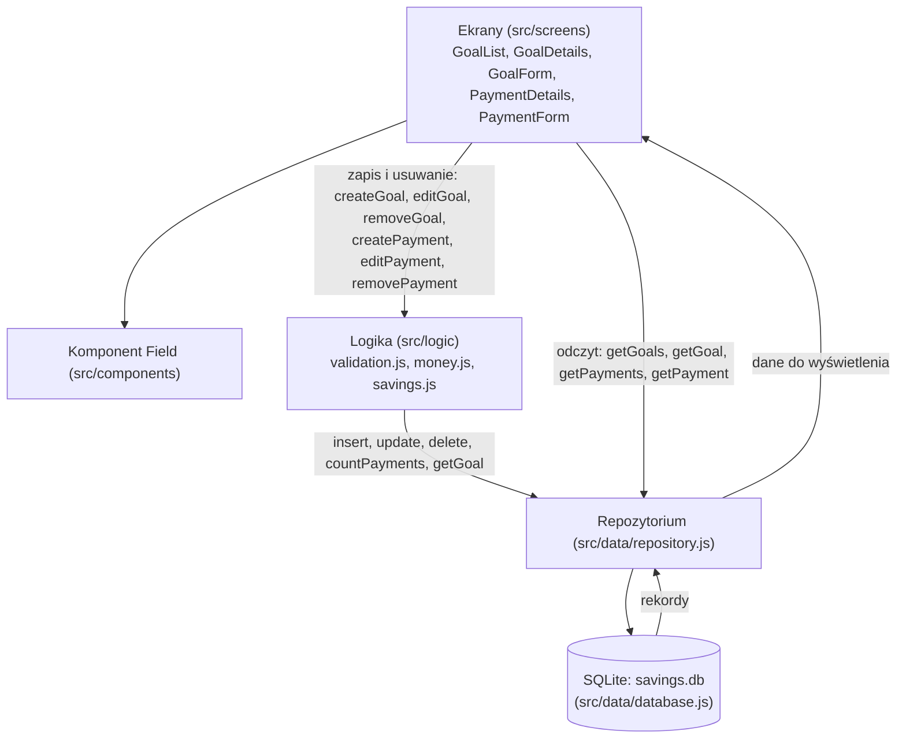
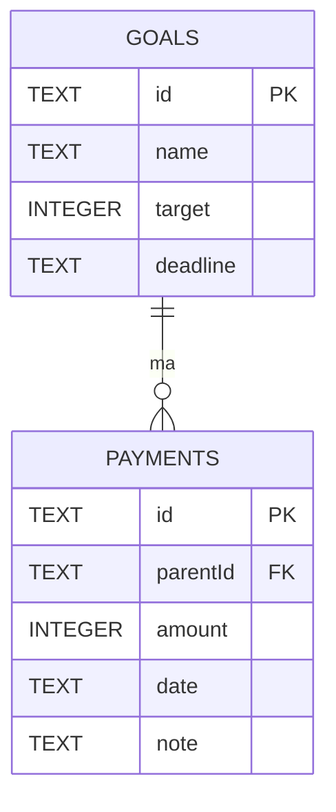

# Architektura aplikacji SavingsGoals

Projekt: MOB-009 - SavingsGoals
Technologia: React Native z Expo, JavaScript (uzasadnienie w [technology-decision.md](technology-decision.md))

## Struktura projektu

| Plik / folder | Warstwa | Odpowiedzialność |
|---|---|---|
| `src/index.js` | Start | Rejestruje główny komponent aplikacji |
| `src/App.js` | Start | Tworzy bazę danych i ustawia nawigację |
| `src/screens/` | Prezentacja | Ekrany: lista celów, szczegóły celu, formularz celu, szczegóły wpłaty, formularz wpłaty |
| `src/components/Field.js` | Prezentacja | Wspólne pole formularza z etykietą i komunikatem błędu |
| `src/styles.js` | Prezentacja | Wspólne style ekranów |
| `src/logic/validation.js` | Logika | Walidacja celu i wpłaty, sprawdzanie dat |
| `src/logic/money.js` | Logika | Zamiana tekstu kwoty na grosze i z powrotem, formatowanie kwot |
| `src/logic/savings.js` | Logika | Tworzenie, edycja i usuwanie celów i wpłat: walidacja, UUID, blokada usunięcia celu z wpłatami |
| `src/data/repository.js` | Dane | Operacje odczytu i zapisu bez ujawniania zapytań SQL innym warstwom |
| `src/data/database.js` | Dane | Połączenie z lokalną bazą SQLite i utworzenie tabel |

## Warstwy i przepływ danych

- **Zapis, edycja i usuwanie** zawsze przechodzą przez logikę, bo tam są reguły biznesowe (walidacja, kwoty, istnienie celu, blokada usunięcia celu z wpłatami).
- **Odczyt** idzie z ekranu prosto do repozytorium, bo nie wymaga reguł biznesowych.
- Logika i repozytorium nie importują żadnych komponentów UI, więc można je testować bez uruchamiania ekranów.

## Model danych

| Tabela | Pole | Typ w bazie | Pole w karcie | Wymagane | Znaczenie |
|---|---|---|---|---|---|
| `goals` | `id` | TEXT (UUID) | `id` | Tak | Identyfikator celu |
| `goals` | `name` | TEXT | `nazwa` | Tak | Nazwa celu |
| `goals` | `target` | INTEGER (grosze) | `kwotaDocelowa` | Tak | Kwota do uzbierania, większa od zera |
| `goals` | `deadline` | TEXT (RRRR-MM-DD) | `termin` | Tak | Planowany termin |
| `payments` | `id` | TEXT (UUID) | `id` | Tak | Identyfikator wpłaty |
| `payments` | `parentId` | TEXT (UUID) | `parentId` | Tak | Cel, do którego należy wpłata |
| `payments` | `amount` | INTEGER (grosze) | `kwota` | Tak | Kwota wpłaty, większa od zera |
| `payments` | `date` | TEXT (RRRR-MM-DD) | `data` | Tak | Dzień wpłaty |
| `payments` | `note` | TEXT | `opis` | Nie | Dodatkowy opis |

**Relacja:** jeden cel ma wiele wpłat (1 do N).

**Spójność danych:**
- `parentId` jest kluczem obcym do `goals(id)` z `ON DELETE RESTRICT`, a przy starcie włączane jest `PRAGMA foreign_keys = ON`. Baza nie pozwoli usunąć celu, który ma wpłaty (MOB-009-BR-04).
- Przed zapisem wpłaty `createPayment` sprawdza, czy cel istnieje.
- Przed usunięciem celu `removeGoal` liczy jego wpłaty. Jeśli są, zwraca komunikat "Nie można usunąć celu, ponieważ ma przypisane wpłaty (N). Najpierw usuń wpłaty." i nic nie usuwa.
- Reguły `CHECK (target > 0)` i `CHECK (amount > 0)` w bazie dublują walidację w logice (MOB-009-BR-01).

**Kwoty i daty:**
- Kwoty są zapisywane w groszach jako liczby całkowite (np. 1500,50 zł to 150050), a nie jako float.
- Daty są zapisywane jako tekst `RRRR-MM-DD`, czyli dzień kalendarzowy bez godziny, więc strefa czasowa nie ma na nie wpływu.

## Zarządzanie stanem

| Rodzaj stanu | Przykład | Gdzie jest |
|---|---|---|
| Stan chwilowy UI | wpisany tekst, komunikaty błędów, trwający zapis, wczytywanie danych do edycji | `useState` w formularzu |
| Stan aplikacyjny | lista celów, wybrany cel i jego wpłaty, wybrana wpłata | `useState` w ekranach list i szczegółów |
| Dane trwałe | zapisane cele i wpłaty | baza SQLite |

Ekrany listy i szczegółów wczytują dane z bazy przy każdym pokazaniu ekranu (`useFocusEffect`). Po zapisie formularz wraca do poprzedniego ekranu, a ten od razu pokazuje aktualne dane.

## Przepływ po naciśnięciu "Zapisz" (nowy cel)

1. `GoalFormScreen` przekazuje dane formularza do `createGoal`.
2. `validateGoal` sprawdza nazwę, kwotę i datę.
3. Jeśli są błędy, `createGoal` je zwraca, a formularz pokazuje je pod polami. Nic nie jest zapisywane.
4. Jeśli dane są poprawne, `createGoal` zamienia kwotę na grosze, nadaje UUID i wywołuje `insertGoal`.
5. `insertGoal` zapisuje rekord w tabeli `goals`.
6. Formularz wraca do listy, pokazuje komunikat "Zapisano cel.", a `GoalListScreen` wczytuje cele ponownie i pokazuje nowy cel.

## Edycja i usuwanie

**Edycja:** ten sam formularz służy do dodawania i edycji. Przy edycji ekran dostaje `id` rekordu, wczytuje go z bazy i wypełnia pola. `editGoal` i `editPayment` zmieniają rekord poleceniem `UPDATE ... WHERE id = ?`, więc nie powstaje nowy rekord. Przycisk "Zapisz" jest wyłączony w trakcie zapisu, co chroni przed podwójnym zapisem. Po zapisie ekran wraca, a lista i szczegóły wczytują aktualne dane.

**Usuwanie:**
- Wpłata: przycisk "Usuń wpłatę" w szczegółach wpłaty, potem okno "Usunąć wpłatę?" z przyciskami "Anuluj" i "Usuń". Po usunięciu aplikacja wraca do szczegółów celu.
- Cel: przycisk "Usuń cel" w szczegółach celu, potem potwierdzenie. Cel z wpłatami nie zostanie usunięty, bo wpłaty bez celu nie mają sensu w tej domenie (MOB-009-BR-04). Użytkownik musi najpierw usunąć wpłaty.

## Obsługa błędów

| Sytuacja | Zachowanie |
|---|---|
| Błędne dane w formularzu | Komunikat pod polem, zapis zablokowany |
| Błąd zapisu w bazie | Okno "Nie udało się zapisać...", dane zostają w formularzu |
| Błąd usuwania | Okno "Nie udało się usunąć...", rekord zostaje |
| Usunięcie celu z wpłatami | Okno "Nie można usunąć celu...", cel zostaje |
| Błąd odczytu z bazy | Komunikat na ekranie listy lub szczegółów |
| Błąd uruchomienia bazy | Ekran z komunikatem "Nie udało się uruchomić bazy danych." |
| Wczytywanie danych | Kółko ładowania |
| Brak rekordów | "Nie masz jeszcze żadnych celów." lub "Brak wpłat dla tego celu." |
| Udany zapis lub usunięcie | Komunikat "Zapisano..." lub "Usunięto..." |

## Decyzje i ograniczenia

| Decyzja | Wybór | Alternatywa | Uzasadnienie |
|---|---|---|---|
| Zarządzanie stanem | `useState` + `useFocusEffect` | Context API, Redux | Mało ekranów i danych, dodatkowa biblioteka byłaby zbędna |
| Przechowywanie danych | SQLite (`expo-sqlite`) | AsyncStorage | Relacje, klucze obce i reguły CHECK, działa w Expo Go |
| Nawigacja | React Navigation (native stack) | Expo Router | Jawna lista ekranów w jednym pliku, przycisk "wstecz" na Androidzie |
| Separacja logiki od UI | Osobne foldery `logic` i `data` | Logika w ekranach | Reguły można testować bez UI, a bazę można wymienić bez zmiany ekranów |

**Ograniczenia:**
- Każde wejście na ekran ponownie czyta dane z bazy. Przy małej ilości danych to nie problem.
- Daty wpisuje się ręcznie w formacie `RRRR-MM-DD`. Komunikat o błędnej dacie nie rozróżnia złego formatu od dnia, który nie istnieje (np. 2026-02-30).
- Wyszukiwanie, filtrowanie, sortowanie i postęp celu nie są jeszcze zaimplementowane.
