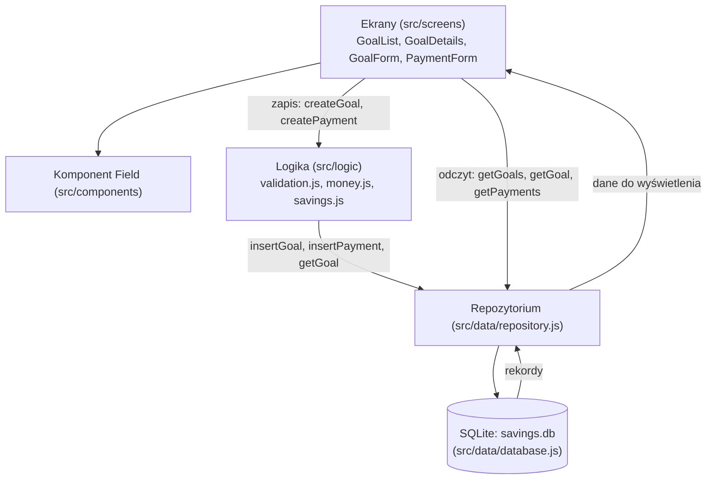
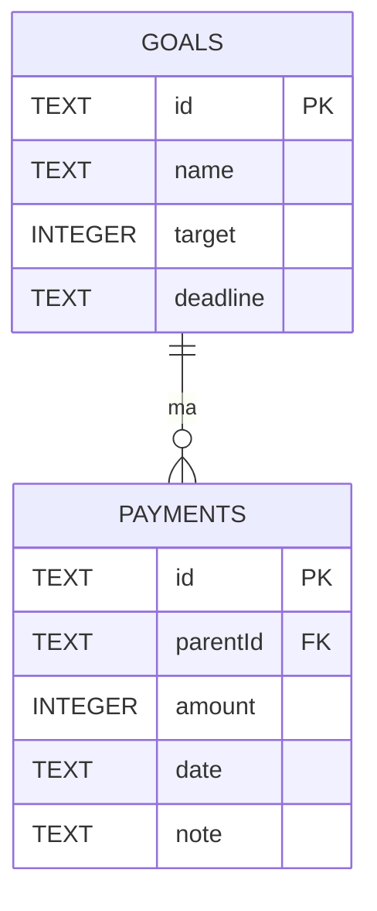

# Architektura aplikacji SavingsGoals

Projekt: MOB-009 - SavingsGoals
Technologia: React Native z Expo, JavaScript (uzasadnienie w [technology-decision.md](technology-decision.md))

## Struktura projektu

| Plik / folder | Warstwa | Odpowiedzialność |
|---|---|---|
| `src/index.js` | Start | Rejestruje główny komponent aplikacji |
| `src/App.js` | Start | Tworzy bazę danych i ustawia nawigację |
| `src/screens/` | Prezentacja | Ekrany: lista celów, szczegóły celu, formularz celu, formularz wpłaty |
| `src/components/Field.js` | Prezentacja | Wspólne pole formularza z etykietą i komunikatem błędu |
| `src/styles.js` | Prezentacja | Wspólne style ekranów |
| `src/logic/validation.js` | Logika | Walidacja celu i wpłaty, sprawdzanie dat |
| `src/logic/money.js` | Logika | Zamiana tekstu kwoty na grosze i formatowanie kwot |
| `src/logic/savings.js` | Logika | Tworzenie celu i wpłaty: walidacja, UUID, zapis przez repozytorium |
| `src/data/repository.js` | Dane | Operacje odczytu i zapisu bez ujawniania zapytań SQL innym warstwom |
| `src/data/database.js` | Dane | Połączenie z lokalną bazą SQLite i utworzenie tabel |

## Warstwy i przepływ danych

- **Zapis** zawsze przechodzi przez logikę, bo tam są reguły biznesowe (walidacja, kwoty, istnienie celu).
- **Odczyt** idzie z ekranu prosto do repozytorium, bo nie wymaga reguł biznesowych.
- Logika i repozytorium nie importują żadnych komponentów UI, więc można je testować bez uruchamiania ekranów.

## Model danych

| Tabela | Pole | Typ w bazie | Pole w karcie | Wymagane | Znaczenie |
|---|---|---|---|---|---|
| `goals` | `id` | TEXT (UUID) | `id` | Tak | Identyfikator celu |
| `goals` | `name` | TEXT | `nazwa` | Tak | Nazwa celu |
| `goals` | `target` | INTEGER (grosze) | `kwotaDocelowa` | Tak | Kwota do uzbierania, większa od zera |
| `goals` | `deadline` | TEXT (RRRR-MM-DD) | `termin` | Tak | Planowany termin |
| `payments` | `id` | TEXT (UUID) | `id` | Tak | Identyfikator wpłaty |
| `payments` | `parentId` | TEXT (UUID) | `parentId` | Tak | Cel, do którego należy wpłata |
| `payments` | `amount` | INTEGER (grosze) | `kwota` | Tak | Kwota wpłaty, większa od zera |
| `payments` | `date` | TEXT (RRRR-MM-DD) | `data` | Tak | Dzień wpłaty |
| `payments` | `note` | TEXT | `opis` | Nie | Dodatkowy opis |

**Relacja:** jeden cel ma wiele wpłat (1 do N).

**Spójność danych:**
- `parentId` jest kluczem obcym do `goals(id)` z `ON DELETE RESTRICT`, a przy starcie włączane jest `PRAGMA foreign_keys = ON`. Baza nie pozwoli usunąć celu, który ma wpłaty (MOB-009-BR-04).
- Przed zapisem wpłaty `createPayment` sprawdza, czy cel istnieje.
- Reguły `CHECK (target > 0)` i `CHECK (amount > 0)` w bazie dublują walidację w logice (MOB-009-BR-01).

**Kwoty i daty:**
- Kwoty są zapisywane w groszach jako liczby całkowite (np. 1500,50 zł to 150050), a nie jako float.
- Daty są zapisywane jako tekst `RRRR-MM-DD`, czyli dzień kalendarzowy bez godziny, więc strefa czasowa nie ma na nie wpływu.

## Zarządzanie stanem

| Rodzaj stanu | Przykład | Gdzie jest |
|---|---|---|
| Stan chwilowy UI | wpisany tekst, komunikaty błędów, trwający zapis | `useState` w formularzu |
| Stan aplikacyjny | lista celów, wybrany cel i jego wpłaty | `useState` w ekranie listy i szczegółów |
| Dane trwałe | zapisane cele i wpłaty | baza SQLite |

Ekrany listy i szczegółów wczytują dane z bazy przy każdym pokazaniu ekranu (`useFocusEffect`). Po zapisie formularz wraca do poprzedniego ekranu, a ten od razu pokazuje aktualne dane.

## Przepływ po naciśnięciu "Zapisz" (nowy cel)

1. `GoalFormScreen` przekazuje dane formularza do `createGoal`.
2. `validateGoal` sprawdza nazwę, kwotę i datę.
3. Jeśli są błędy, `createGoal` je zwraca, a formularz pokazuje je pod polami. Nic nie jest zapisywane.
4. Jeśli dane są poprawne, `createGoal` zamienia kwotę na grosze, nadaje UUID i wywołuje `insertGoal`.
5. `insertGoal` zapisuje rekord w tabeli `goals`.
6. Formularz wraca do listy, a `GoalListScreen` wczytuje cele ponownie i pokazuje nowy cel.

## Obsługa błędów

| Sytuacja | Zachowanie |
|---|---|
| Błędne dane w formularzu | Komunikat pod polem, zapis zablokowany |
| Błąd zapisu w bazie | Okno "Nie udało się zapisać...", dane zostają w formularzu |
| Błąd odczytu z bazy | Komunikat na ekranie listy lub szczegółów |
| Błąd uruchomienia bazy | Ekran z komunikatem "Nie udało się uruchomić bazy danych." |
| Brak rekordów | "Nie masz jeszcze żadnych celów." lub "Brak wpłat dla tego celu." |

## Decyzje i ograniczenia

| Decyzja | Wybór | Alternatywa | Uzasadnienie |
|---|---|---|---|
| Zarządzanie stanem | `useState` + `useFocusEffect` | Context API, Redux | Mało ekranów i danych, dodatkowa biblioteka byłaby zbędna |
| Przechowywanie danych | SQLite (`expo-sqlite`) | AsyncStorage | Relacje, klucze obce i reguły CHECK, działa w Expo Go |
| Nawigacja | React Navigation (native stack) | Expo Router | Jawna lista ekranów w jednym pliku, przycisk "wstecz" na Androidzie |
| Separacja logiki od UI | Osobne foldery `logic` i `data` | Logika w ekranach | Reguły można testować bez UI, a bazę można wymienić bez zmiany ekranów |

**Ograniczenia:**
- Każde wejście na ekran ponownie czyta dane z bazy. Przy małej ilości danych to nie problem.
- Daty wpisuje się ręcznie w formacie `RRRR-MM-DD`.
- Edycja, usuwanie, wyszukiwanie, filtrowanie, sortowanie i postęp celu będą dodane w kolejnych laboratoriach.
