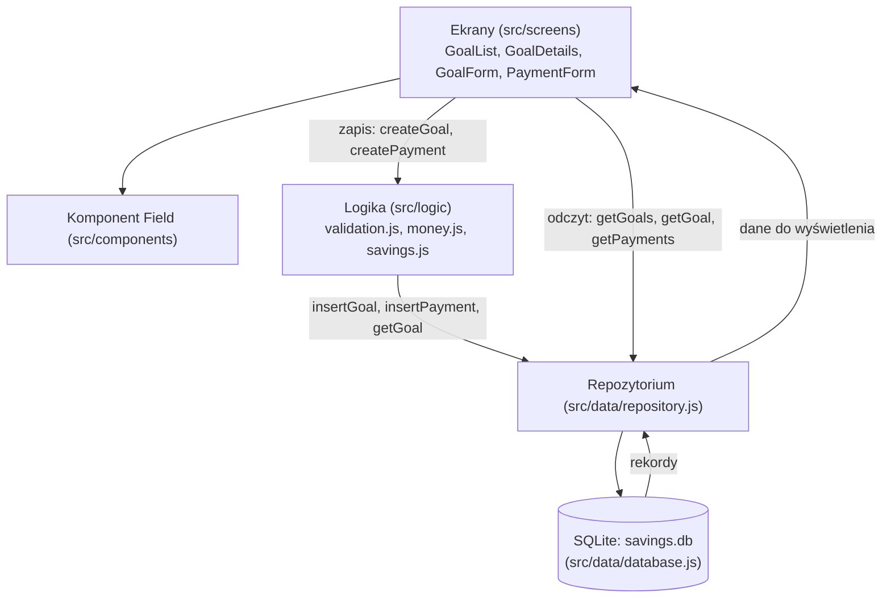
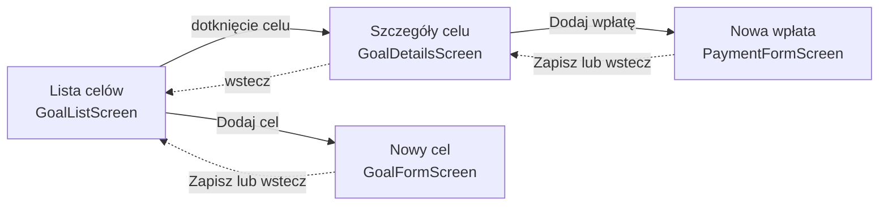
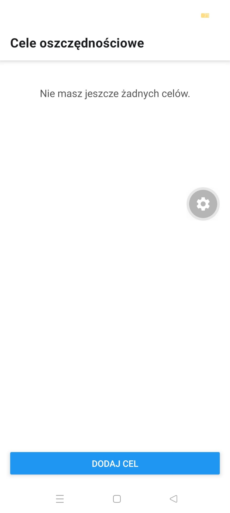
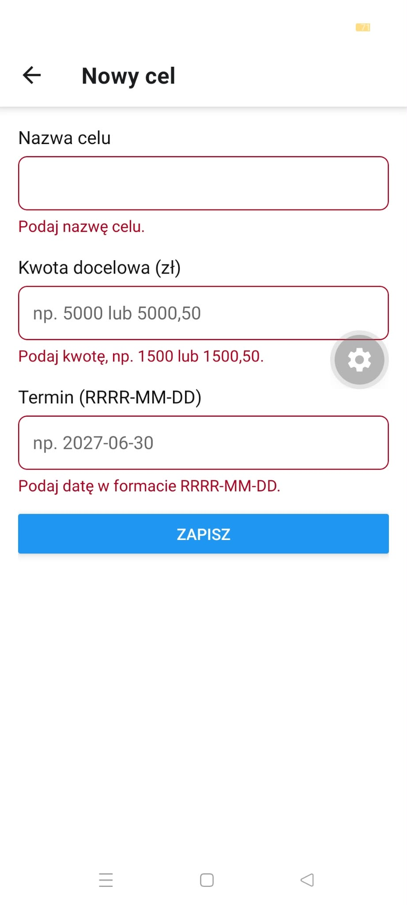
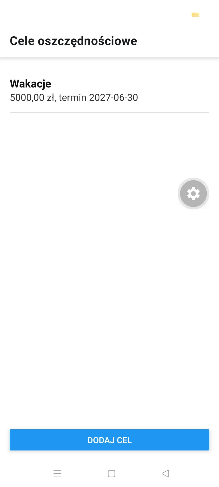
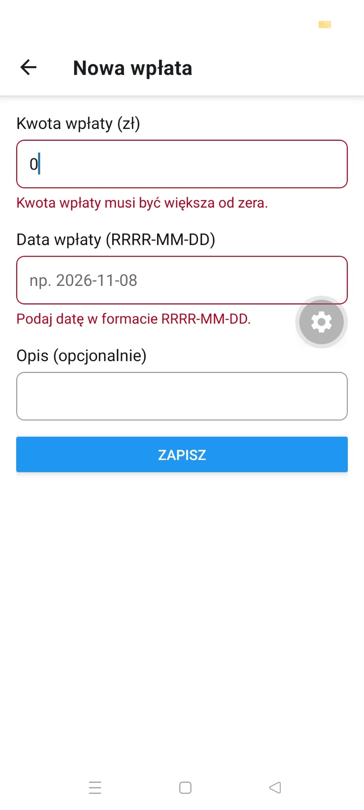
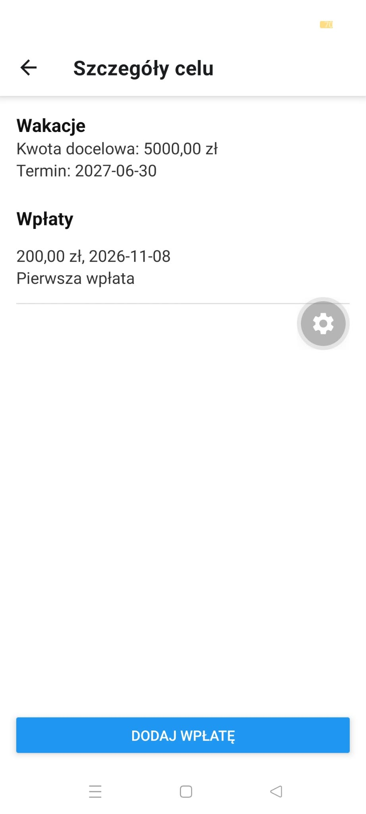
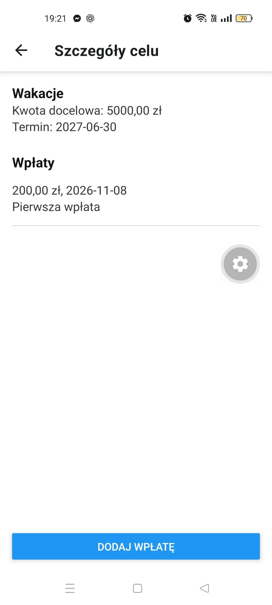

# Sprawozdanie - Laboratorium 2

**Przedmiot:** Budowa aplikacji mobilnych z użyciem technologii frontendowych  
**Student / identyfikator:** Dawid Wiśniewski, 147766  
**Projekt biznesowy:** MOB-009 - SavingsGoals  
**Framework:** React Native (Expo)  
**Data zajęć:** 2026-11-07  
**Repozytorium:** https://github.com/dwisniewski299/WSB_Budowa_aplikacji_mobilnych  
**Commit / tag odpowiadający oddaniu:** tag `lab-02`

## T1. Analiza podejść do tworzenia aplikacji

| Wymaganie z projektu | Znaczenie dla wyboru technologii | Wniosek |
| -------------------- | -------------------------------- | ------- |
| MOB-009-FR-11 i TECH-04: dane zostają po ponownym uruchomieniu | Potrzebna lokalna baza działająca bez internetu. Aplikacje natywne i wieloplatformowe mają dostęp do SQLite. W WebView i PWA zapis zależy od przeglądarki i wtyczek. | Wystarczy React Native z `expo-sqlite`, które działa w Expo Go |
| MOB-009-FR-04 i FR-08: lista, szczegóły, formularze z walidacją | Potrzebne komponenty list, pola tekstowe i nawigacja z przyciskiem "wstecz" na Androidzie | React Native ma `FlatList` i `TextInput`, a React Navigation daje stos ekranów |
| TECH-01 i TECH-02: aplikacja mobilna na Androidzie, wykonywana przez jedną osobę | Natywne podejście wymaga osobnego kodu w Kotlinie i Swifcie. Według `requirements.md` rozwiązanie oparte wyłącznie na PWA nie spełnia TECH-01. | Jeden wspólny kod JavaScript w React Native |

**Porównanie podejść i uzasadnienie:**

- **Natywne (Kotlin, Swift):** pełny dostęp do SQLite i API systemu, ale dla Androida i iOS trzeba pisać dwie osobne aplikacje. Przy jednej osobie i prostym CRUD to zbędny koszt.
- **Hybrydowe WebView (np. Ionic z Capacitor):** interfejs z HTML i CSS wyświetlany w WebView, a dostęp do bazy przez wtyczki. Działa, ale formularze i listy nie są natywnymi kontrolkami, a trwałość danych zależy od wtyczki.
- **Wieloplatformowe (React Native, Flutter, NativeScript):** wspólny kod i natywny lub własny interfejs bez WebView. Lokalną bazę zapewnia biblioteka, np. `expo-sqlite`.
- **PWA:** strona w przeglądarce z manifestem i service workerem. Dane w przeglądarce może usunąć system lub użytkownik, a samo PWA nie spełnia TECH-01.

Framework wybrany w laboratorium 1 (React Native z Expo) pozostaje odpowiedni. Implementacja w laboratorium 2 to potwierdziła: SQLite, nawigacja i formularze działają w Expo Go bez kodu natywnego i bez instalacji Android Studio.

**Wskazane źródła (dokumentacja, artykuły techniczne):**

1. React Native, Core Components and Native Components: https://reactnative.dev/docs/intro-react-native-components
2. Expo SQLite: https://docs.expo.dev/versions/latest/sdk/sqlite/
3. React Navigation, Native Stack Navigator: https://reactnavigation.org/docs/native-stack-navigator
4. React Navigation, useFocusEffect: https://reactnavigation.org/docs/use-focus-effect
5. Capacitor: https://capacitorjs.com/docs
6. MDN, Progressive Web Apps: https://developer.mozilla.org/en-US/docs/Web/Progressive_web_apps
7. Android, Jetpack Compose: https://developer.android.com/compose
8. Apple, SwiftUI: https://developer.apple.com/xcode/swiftui/

Data dostępu do źródeł: 2026-11-08.

## T2. Projekt architektury aplikacji

### T2.1. Diagram architektury

**Diagram / odnośnik:** pełny opis w [docs/architecture.md](../docs/architecture.md).

Zapis przechodzi przez logikę, bo tam są reguły biznesowe. Odczyt idzie z ekranu prosto do repozytorium, bo nie wymaga reguł. Logika i repozytorium nie importują komponentów UI.

### T2.2. Model danych

| Encja | Pole | Typ | Wymagane | Znaczenie |
| ----- | ---- | --- | -------- | --------- |
| Cel oszczędnościowy (`goals`) | `id` | UUID (TEXT) | Tak | Identyfikator celu |
| Cel oszczędnościowy (`goals`) | `name` | TEXT | Tak | Nazwa celu, nie może być pusta |
| Cel oszczędnościowy (`goals`) | `target` | INTEGER, grosze | Tak | Kwota docelowa, większa od zera |
| Cel oszczędnościowy (`goals`) | `deadline` | TEXT, RRRR-MM-DD | Tak | Termin realizacji |
| Wpłata (`payments`) | `id` | UUID (TEXT) | Tak | Identyfikator wpłaty |
| Wpłata (`payments`) | `parentId` | UUID (TEXT) | Tak | Cel, do którego należy wpłata |
| Wpłata (`payments`) | `amount` | INTEGER, grosze | Tak | Kwota wpłaty, większa od zera |
| Wpłata (`payments`) | `date` | TEXT, RRRR-MM-DD | Tak | Dzień wpłaty |
| Wpłata (`payments`) | `note` | TEXT | Nie | Opis |

**Relacja i sposób zapewnienia spójności (np. usuwanie encji nadrzędnej):**

Jeden cel ma wiele wpłat (1 do N). Pole `parentId` jest kluczem obcym do `goals(id)` z `ON DELETE RESTRICT`, a przy starcie aplikacji włączane jest `PRAGMA foreign_keys = ON`. Baza nie pozwoli usunąć celu, który ma wpłaty (MOB-009-BR-04). Przed zapisem wpłaty funkcja `createPayment` sprawdza, czy cel istnieje. Kwoty są zapisywane w groszach jako liczby całkowite, a reguły `CHECK (target > 0)` i `CHECK (amount > 0)` dublują walidację w logice (MOB-009-BR-01).

### T2.3. Decyzje projektowe

| Decyzja | Wybrane rozwiązanie | Alternatywa | Uzasadnienie |
| ------- | ------------------- | ----------- | ------------ |
| Zarządzanie stanem | `useState` w ekranach i ponowny odczyt danych przy wejściu na ekran (`useFocusEffect`) | Context API, Redux | Mało ekranów i danych, globalny magazyn stanu byłby zbędny |
| Przechowywanie danych | SQLite (`expo-sqlite`) | AsyncStorage | Relacje, klucze obce i reguły CHECK, działa w Expo Go |
| Nawigacja | React Navigation (native stack) | Expo Router | Lista ekranów w jednym pliku `App.js`, przycisk "wstecz" na Androidzie |
| Separacja logiki od UI | Foldery `src/logic` i `src/data` | Logika i SQL w ekranach | Reguły można testować bez UI, a bazę można wymienić bez zmiany ekranów |

**Plik `docs/architecture.md`:** [docs/architecture.md](../docs/architecture.md)

## T3. Nawigacja i ekrany

**Schemat nawigacji:**

| Ekran | Plik / komponent | Przejście do / z ekranu | Dowód działania |
| ----- | ---------------- | ----------------------- | --------------- |
| Lista | [src/screens/GoalListScreen.js](../src/screens/GoalListScreen.js) | Do szczegółów (dotknięcie celu), do formularza celu ("Dodaj cel") | [01-empty-list.jpg](assets/lab-02/01-empty-list.jpg), [03-goal-list.jpg](assets/lab-02/03-goal-list.jpg) |
| Szczegóły | [src/screens/GoalDetailsScreen.js](../src/screens/GoalDetailsScreen.js) | Z listy, do formularza wpłaty ("Dodaj wpłatę"), wstecz do listy | [05-goal-details.jpg](assets/lab-02/05-goal-details.jpg) |
| Formularz celu | [src/screens/GoalFormScreen.js](../src/screens/GoalFormScreen.js) | Z listy, po zapisie wraca do listy | [02-goal-form-errors.jpg](assets/lab-02/02-goal-form-errors.jpg) |
| Formularz wpłaty | [src/screens/PaymentFormScreen.js](../src/screens/PaymentFormScreen.js) | Ze szczegółów, po zapisie wraca do szczegółów | [04-payment-form-error.jpg](assets/lab-02/04-payment-form-error.jpg) |

Oba formularze korzystają z jednego komponentu pola [src/components/Field.js](../src/components/Field.js).

**Dlaczego taki układ nawigacji jest odpowiedni dla użytkownika?**

Ekran startowy to lista celów, bo od niej zaczyna się każda czynność. Wpłatę dodaje się z poziomu szczegółów celu, więc zawsze trafia do właściwego celu i użytkownik nie musi wybierać go z listy (MOB-009-FR-03). Po zapisie aplikacja wraca do ekranu, z którego przyszedł użytkownik, i od razu pokazuje nowy rekord. Systemowy przycisk "wstecz" na Androidzie działa na każdym ekranie.

## T4. Operacje Create i Read

**Powiązanie z wymaganiami biznesowymi (ID wymagań):** MOB-009-FR-01 (dodawanie i wyświetlanie wpłat), MOB-009-FR-02 (tworzenie i przeglądanie celów), MOB-009-FR-03, MOB-009-FR-04, MOB-009-FR-08, MOB-009-FR-11, MOB-009-BR-01, MOB-009-BR-03, MOB-009-BR-04.

| Operacja | Lokalizacja kodu | Reguła walidacji / zachowanie | Wynik |
| -------- | ---------------- | ----------------------------- | ----- |
| Create (cel) | `GoalFormScreen.js`, `createGoal` w [savings.js](../src/logic/savings.js), `insertGoal` w [repository.js](../src/data/repository.js) | Nazwa niepusta, kwota większa od zera, data w formacie RRRR-MM-DD | Cel zapisany i widoczny na liście |
| Create (wpłata) | `PaymentFormScreen.js`, `createPayment`, `insertPayment` | Kwota większa od zera, poprawna data, cel musi istnieć | Wpłata widoczna w szczegółach celu, kwota 0 zablokowana |
| Read (lista) | `GoalListScreen.js`, `getGoals` | Cele posortowane po nazwie, odświeżenie przy powrocie na ekran, komunikat pustej listy | Lista pokazuje zapisane cele |
| Read (szczegóły) | `GoalDetailsScreen.js`, `getGoal`, `getPayments` | Dane celu i jego wpłaty od najnowszej | Poprawne dane celu i wpłat |

Walidacja jest w [validation.js](../src/logic/validation.js), a zamiana kwot na grosze w [money.js](../src/logic/money.js).

**Wyjaśnij przepływ danych po naciśnięciu przycisku „Zapisz”:**

1. `GoalFormScreen` przekazuje wpisane dane do `createGoal`.
2. `validateGoal` sprawdza nazwę, kwotę i datę.
3. Jeśli są błędy, `createGoal` je zwraca, a formularz pokazuje je pod polami. Nic nie jest zapisywane.
4. Jeśli dane są poprawne, `createGoal` zamienia kwotę na grosze, nadaje UUID (`expo-crypto`) i wywołuje `insertGoal`.
5. `insertGoal` zapisuje rekord w tabeli `goals` w bazie SQLite.
6. Formularz wraca do listy, `useFocusEffect` w `GoalListScreen` ponownie wczytuje cele i lista pokazuje nowy rekord.
7. Jeśli zapis w bazie się nie uda, pojawia się okno z komunikatem, a dane zostają w formularzu.

## T5. Weryfikacja działania i wnioski

Testy ręczne wykonano na telefonie Realme 9 (Android 14) w Expo Go.

| ID | Scenariusz | Oczekiwany rezultat | Wynik (PASS/FAIL) | Dowód / uwagi |
| -- | ---------- | ------------------- | ----------------- | ------------- |
| TC-01 | Dodanie poprawnego rekordu | Rekord jest zapisany i widoczny | PASS | Cel "Wakacje", 5000,00 zł, termin 2027-06-30: [03-goal-list.jpg](assets/lab-02/03-goal-list.jpg) |
| TC-02 | Próba zapisu pustego wymaganego pola | Zapis zablokowany, komunikat | PASS | Trzy komunikaty pod polami: [02-goal-form-errors.jpg](assets/lab-02/02-goal-form-errors.jpg) |
| TC-03 | Otwarcie szczegółów rekordu | Poprawne dane rekordu | PASS | Szczegóły celu z wpłatą 200,00 zł: [05-goal-details.jpg](assets/lab-02/05-goal-details.jpg) |
| TC-04 | Ponowne uruchomienie aplikacji | Rekord pozostaje dostępny | PASS | Cel i wpłata po zamknięciu i ponownym otwarciu: [06-after-restart.jpg](assets/lab-02/06-after-restart.jpg) |
| TC-05 | Brak rekordów | Czytelny stan pustej listy | PASS | "Nie masz jeszcze żadnych celów.": [01-empty-list.jpg](assets/lab-02/01-empty-list.jpg) |
| TC-06 | Wpłata o kwocie 0 (MOB-009-BR-01) | Zapis zablokowany, komunikat | PASS | "Kwota wpłaty musi być większa od zera.": [04-payment-form-error.jpg](assets/lab-02/04-payment-form-error.jpg) |

Po scaleniu PR aplikację uruchomiono jeszcze raz z gałęzi `main`. Dane nadal były widoczne.

     

**Najważniejszy napotkany problem i sposób rozwiązania:**

Po dodaniu bibliotek nawigacji i przeładowaniu aplikacji ikony na pasku stanu telefonu były białe na białym tle, więc godzina i powiadomienia były niewidoczne (zrzuty 01 do 05). Prawdopodobną przyczyną było to, że ustawienia paska stanu nie odświeżyły się przy szybkim przeładowaniu. Pomogło pełne zamknięcie i ponowne uruchomienie aplikacji: na zrzucie 06 pasek jest już poprawny. Mniejszy problem: przy sprawdzaniu po scaleniu port 8081 był zajęty przez poprzednio uruchomiony serwer Expo, więc aplikację uruchomiono na porcie 8082.

**Co wymaga dalszej pracy przed laboratorium 3?**

- Edycja i usuwanie wpłat z potwierdzeniem usunięcia (MOB-009-FR-01, FR-09).
- Edycja celu i blokada usunięcia celu z wpłatami z czytelnym komunikatem (MOB-009-FR-02, BR-04).
- Wyszukiwanie, filtrowanie i sortowanie z wyborem kierunku (MOB-009-FR-05 do FR-07).
- Obliczanie i wyświetlanie postępu celu (MOB-009-FR-10, BR-02).
- Komunikat po udanym zapisie.

**Wnioski (3-6 zdań, odnoszące się do własnej implementacji):**

Podział na ekrany, logikę i repozytorium sprawił, że formularze tylko zbierają dane i pokazują błędy, a reguły są w jednym miejscu (`validation.js`). Zapis kwot w groszach jako liczb całkowitych pozwolił uniknąć błędów zaokrągleń typu float. Klucz obcy z `ON DELETE RESTRICT` pilnuje spójności relacji już na poziomie bazy, niezależnie od interfejsu. Ponowne wczytywanie danych przy wejściu na ekran okazało się prostym sposobem na aktualną listę po powrocie z formularza. Ręczne wpisywanie dat działa, ale jest mało wygodne i warto je poprawić w kolejnych etapach.

## Materiały dowodowe i historia pracy

- Issue(s): [#3 feature: Architektura, nawigacja oraz dodawanie celów i wpłat](https://github.com/dwisniewski299/WSB_Budowa_aplikacji_mobilnych/issues/3)
- Pull Request(s): [#4 feat: add goals and payments with sqlite storage](https://github.com/dwisniewski299/WSB_Budowa_aplikacji_mobilnych/pull/4)
- Commity związane z laboratorium:
  - [81948ec](https://github.com/dwisniewski299/WSB_Budowa_aplikacji_mobilnych/commit/81948ec) chore: add navigation, sqlite and crypto libraries
  - [f631bb3](https://github.com/dwisniewski299/WSB_Budowa_aplikacji_mobilnych/commit/f631bb3) feat(data): add sqlite storage, repository and validation
  - [54e63b2](https://github.com/dwisniewski299/WSB_Budowa_aplikacji_mobilnych/commit/54e63b2) feat(goals): add screens and navigation for goals and payments
  - [594847e](https://github.com/dwisniewski299/WSB_Budowa_aplikacji_mobilnych/commit/594847e) docs: add architecture description
  - [98de07c](https://github.com/dwisniewski299/WSB_Budowa_aplikacji_mobilnych/commit/98de07c) docs: add lab 02 screenshots
  - [7692f79](https://github.com/dwisniewski299/WSB_Budowa_aplikacji_mobilnych/commit/7692f79) Merge pull request #4
- Diagramy: [docs/architecture.md](../docs/architecture.md) oraz sekcje T2.1 i T3 tego sprawozdania (Mermaid)
- Zrzuty ekranu: [reports/assets/lab-02/](assets/lab-02/)
- Instrukcja uruchomienia: [README.md](../README.md)
