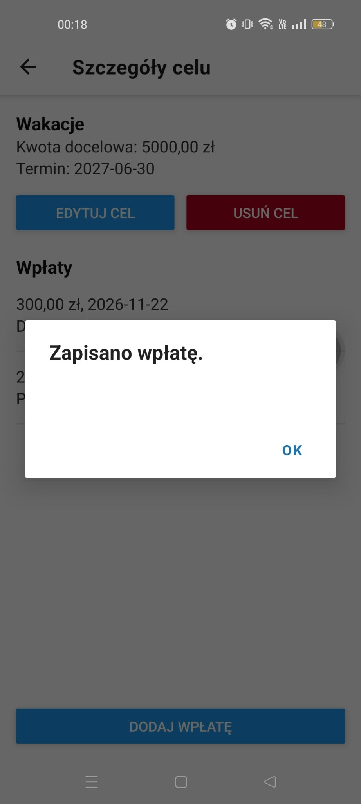
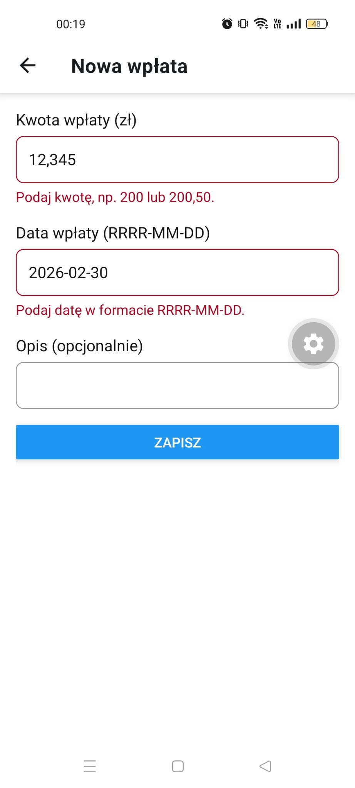
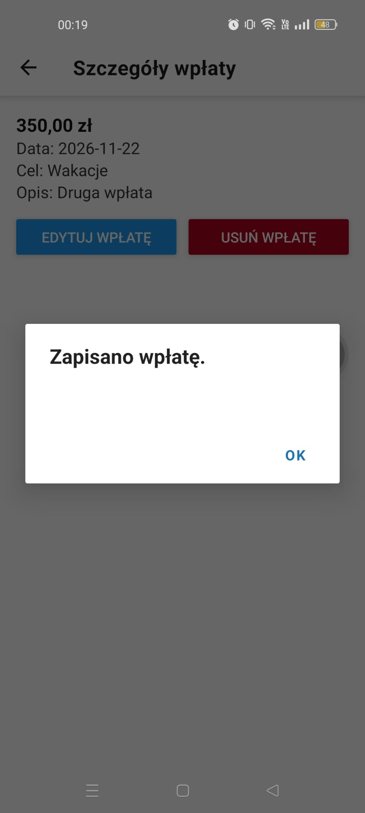
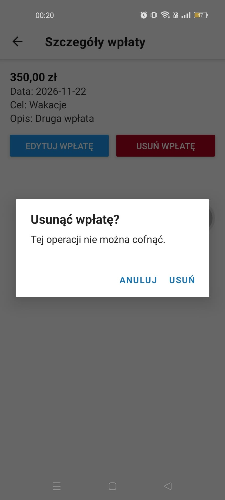
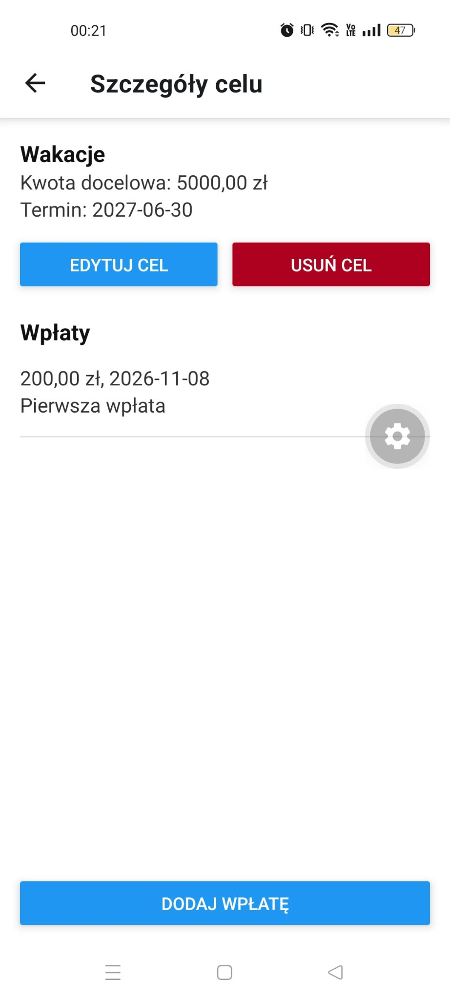
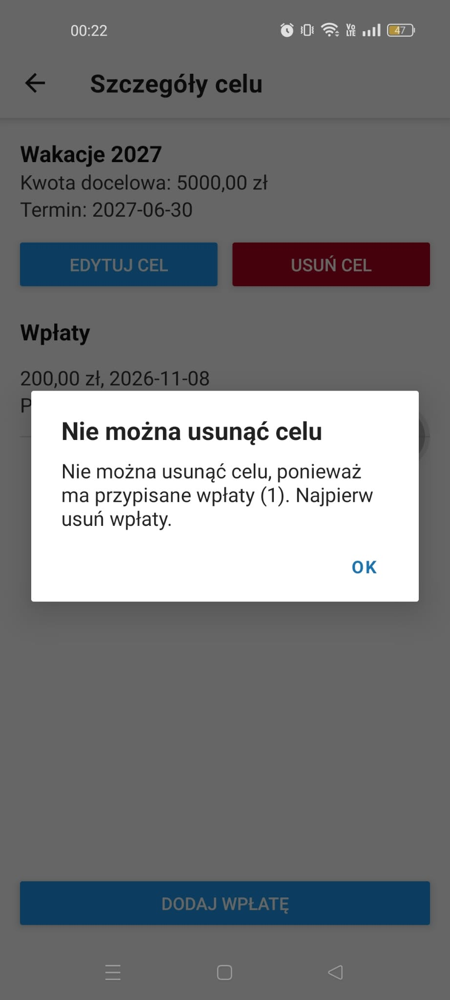

# Laboratorium 3 - sprawozdanie projektowe

**Przedmiot:** Budowa aplikacji mobilnych z użyciem technologii frontendowych  
**Student / identyfikator:** Dawid Wiśniewski, 147766  
**Projekt biznesowy:** MOB-009 - SavingsGoals  
**Framework:** React Native (Expo)  
**Data zajęć:** 2026-11-21  
**Repozytorium:** https://github.com/dwisniewski299/WSB_Budowa_aplikacji_mobilnych  
**Commit / tag odpowiadający oddaniu:** tag `lab-03`

## T1. Analiza zmian w architekturze interfejsu

**Odpowiedź:**

Wybrany problem: **odświeżenie listy wpłat w szczegółach celu po dodaniu, edycji albo usunięciu wpłaty.**

Przy ręcznej manipulacji widokiem (np. czysty JavaScript albo jQuery na stronie WWW) po każdej operacji trzeba samemu zmienić drzewo DOM. Po dodaniu wpłaty trzeba utworzyć nowy element listy i wstawić go we właściwe miejsce. Po edycji trzeba znaleźć element po identyfikatorze i podmienić jego tekst, a po usunięciu go usunąć. Każda operacja wymaga osobnego kodu, a pominięcie jednego miejsca, np. nazwy celu w szczegółach wpłaty, daje widok niezgodny z danymi.

W React Native widok jest opisany deklaratywnie jako funkcja stanu. W pliku [src/screens/GoalDetailsScreen.js](../src/screens/GoalDetailsScreen.js) komponent `GoalDetailsScreen` trzyma wpłaty w stanie `payments` (`useState`). Hook `useFocusEffect` przy każdym pokazaniu ekranu odczytuje wpłaty z bazy (`getPayments`) i wywołuje `setPayments`. React sam przelicza widok, a `FlatList` rysuje listę na nowo. Ten sam kod obsługuje dodanie, edycję i usunięcie, bo po powrocie z formularza albo ze szczegółów wpłaty ekran zawsze pokazuje aktualny stan bazy.

Korzyści:
- jedno źródło prawdy (baza SQLite), z którego widok jest zawsze odtwarzany,
- brak osobnego kodu aktualizacji widoku dla każdej operacji,
- mniejsze ryzyko niespójności między danymi a ekranem.

Koszty:
- przy każdym wejściu na ekran lista jest wczytywana z bazy ponownie, nawet jeśli nic się nie zmieniło,
- trzeba rozumieć działanie hooków i zależności `useCallback`,
- przy bardzo dużej liczbie wpłat ponowne wczytywanie całej listy byłoby nieefektywne.

**Dowód w repozytorium:** [src/screens/GoalDetailsScreen.js](../src/screens/GoalDetailsScreen.js), commit [a54c517](https://github.com/dwisniewski299/WSB_Budowa_aplikacji_mobilnych/commit/a54c517). Lista przed i po usunięciu: [m1-payment-list.jpg](assets/lab-03/m1-payment-list.jpg), [m4-payment-deleted.jpg](assets/lab-03/m4-payment-deleted.jpg).

## T2. Implementacja Create i Read oraz przepływ danych

- Encja główna: **Wpłata (tabela `payments`), przypisana do celu oszczędnościowego (tabela `goals`).**
- Model danych i identyfikator rekordu: **`id` (UUID z `expo-crypto`, klucz główny), `parentId` (UUID celu, klucz obcy), `amount` (grosze jako liczba całkowita), `date` (tekst RRRR-MM-DD), `note` (opcjonalny tekst).**
- Ścieżka operacji Create (ekran → walidacja → logika → zapis): **`PaymentFormScreen` (funkcja `save`) → `createPayment` w [savings.js](../src/logic/savings.js) → `validatePayment` w [validation.js](../src/logic/validation.js) → sprawdzenie, czy cel istnieje (`getGoal`) → `insertPayment` w [repository.js](../src/data/repository.js) → tabela `payments` w SQLite.**
- Ścieżka operacji Read (źródło → lista → szczegóły): **SQLite → `getPayments(parentId)` → lista w `GoalDetailsScreen` → dotknięcie wpłaty → `PaymentDetailsScreen` odczytuje `getPayment(id)` oraz nazwę celu przez `getGoal(parentId)`.**
- Jak odróżniasz pustą listę od błędu odczytu? **Błąd odczytu trafia do bloku `catch` i ustawia stan `error`, a ekran pokazuje czerwony komunikat, np. "Nie udało się wczytać danych celu.". Pusta lista oznacza udane zapytanie bez wyników i wtedy `FlatList` pokazuje "Brak wpłat dla tego celu." albo "Nie masz jeszcze żadnych celów.". Zanim dane się wczytają, widać kółko ładowania.**

Operacje Create i Read powstały w laboratorium 2 i zostały zweryfikowane ponownie w teście M1.

**Dowody:** commity [f631bb3](https://github.com/dwisniewski299/WSB_Budowa_aplikacji_mobilnych/commit/f631bb3) i [54e63b2](https://github.com/dwisniewski299/WSB_Budowa_aplikacji_mobilnych/commit/54e63b2) z laboratorium 2, [src/screens/PaymentDetailsScreen.js](../src/screens/PaymentDetailsScreen.js), zrzuty [m1-payment-saved.jpg](assets/lab-03/m1-payment-saved.jpg) i [m1-payment-list.jpg](assets/lab-03/m1-payment-list.jpg).

## T3. Implementacja Update i Delete

**Odpowiedź:**

1. **Identyfikacja edytowanego rekordu.** Ten sam formularz służy do dodawania i edycji. Przy edycji ekran dostaje w parametrach nawigacji `id` wpłaty, wczytuje ją (`getPayment`) i wypełnia pola. Zapis wywołuje `editPayment(id, form)`, a repozytorium wykonuje `UPDATE payments ... WHERE id = ?`. Nowy UUID i `INSERT` powstają tylko wtedy, gdy formularz nie dostał `id`. Przed duplikatem przy szybkim podwójnym dotknięciu chroni wyłączenie przycisku "Zapisz" na czas zapisu (stan `saving`).
2. **Po zatwierdzeniu edycji** formularz wraca do szczegółów wpłaty i pokazuje komunikat "Zapisano wpłatę.". `PaymentDetailsScreen` przy powrocie wczytuje wpłatę ponownie (`useFocusEffect`), więc widać nowe wartości. Lista w szczegółach celu odświeża się tak samo przy powrocie. Edycja celu działa analogicznie (`editGoal`).
3. **Usuwanie wpłaty:** przycisk "Usuń wpłatę" otwiera okno "Usunąć wpłatę?" z przyciskami "Anuluj" i "Usuń". Po potwierdzeniu `removePayment` usuwa rekord, aplikacja wraca do szczegółów celu i pokazuje "Usunięto wpłatę.". Cel zostaje, zmienia się tylko jego lista wpłat. **Usuwanie celu:** po potwierdzeniu `removeGoal` liczy wpłaty celu (`countPayments`). Jeśli są, operacja jest blokowana z komunikatem "Nie można usunąć celu, ponieważ ma przypisane wpłaty (N). Najpierw usuń wpłaty.". Dodatkowo baza ma klucz obcy z `ON DELETE RESTRICT`.
4. **Dlaczego blokada.** Wpłata bez celu nie ma sensu, bo cała aplikacja polega na przypisaniu wpłat do celów. Kaskadowe usunięcie skasowałoby bez ostrzeżenia historię oszczędzania, a przeniesienie wpłat do innego celu zafałszowałoby postęp innego celu. Blokada wymusza świadomą decyzję użytkownika i jest zgodna z regułą karty MOB-009-BR-04.

**Dowody:** commity [06f210c](https://github.com/dwisniewski299/WSB_Budowa_aplikacji_mobilnych/commit/06f210c) (repozytorium i logika) i [a54c517](https://github.com/dwisniewski299/WSB_Budowa_aplikacji_mobilnych/commit/a54c517) (ekrany), pliki [savings.js](../src/logic/savings.js), [repository.js](../src/data/repository.js), [PaymentFormScreen.js](../src/screens/PaymentFormScreen.js), [PaymentDetailsScreen.js](../src/screens/PaymentDetailsScreen.js), [GoalDetailsScreen.js](../src/screens/GoalDetailsScreen.js).

## T4. Walidacja i reguła biznesowa

| Pole / operacja | Warunek poprawności | Zachowanie przy błędzie | Lokalizacja implementacji |
| --------------- | ------------------- | ----------------------- | ------------------------- |
| Kwota wpłaty (dodawanie i edycja) | Liczba większa od zera, najwyżej 2 miejsca po przecinku (reguła MOB-009-BR-01) | Komunikat pod polem, np. "Kwota wpłaty musi być większa od zera.", zapis zablokowany | `validatePayment` w [validation.js](../src/logic/validation.js), `parseAmount` w [money.js](../src/logic/money.js), `CHECK (amount > 0)` w [database.js](../src/data/database.js) |
| Data wpłaty | Istniejący dzień w formacie RRRR-MM-DD | "Podaj datę w formacie RRRR-MM-DD.", zapis zablokowany | `isValidDate` w [validation.js](../src/logic/validation.js) |
| Nazwa celu | Niepusta po usunięciu spacji | "Podaj nazwę celu.", zapis zablokowany | `validateGoal` w [validation.js](../src/logic/validation.js) |
| Usunięcie celu (reguła MOB-009-BR-04) | Cel nie ma przypisanych wpłat | Okno "Nie można usunąć celu, ponieważ ma przypisane wpłaty (N)...", cel zostaje | `removeGoal` w [savings.js](../src/logic/savings.js), `ON DELETE RESTRICT` w [database.js](../src/data/database.js) |

**Dlaczego sama blokada przycisku w UI nie wystarcza?**

Przycisk pilnuje tylko jednego ekranu. Te same dane trafiają do bazy z dwóch miejsc (dodawanie i edycja), a w przyszłości mogłyby też trafić np. z importu. Gdyby reguła była tylko w UI, wystarczy jedno przeoczone miejsce albo błąd w ekranie, żeby w bazie pojawiła się wpłata z kwotą 0 albo wpłata bez celu. Dlatego reguły są w warstwie logiki, przez którą przechodzi każdy zapis, a baza ma dodatkowe ograniczenia `CHECK` i klucz obcy. Wyłączony przycisk nie mówi też użytkownikowi, co jest źle, a komunikat pod polem tak. Reguły w logice można też sprawdzić testami bez uruchamiania aplikacji.

## T5. Stan aplikacji, trwałość i obsługa błędów

- Wskaż przykład stanu tymczasowego i stanu trwałego: **Tymczasowy: wpisany tekst, komunikaty błędów i flaga `saving` w `PaymentFormScreen` (`useState`). Znikają po wyjściu z ekranu. Trwały: cele i wpłaty w pliku bazy `savings.db` (SQLite).**
- Jak dane są odczytywane po ponownym uruchomieniu aplikacji? **`App.js` przy starcie wywołuje `setupDatabase`, które otwiera istniejący plik bazy. `CREATE TABLE IF NOT EXISTS` nie usuwa danych. Każdy ekran przy pokazaniu odczytuje dane z bazy (`getGoals`, `getPayments`, `getPayment`).**
- Jak obsługujesz stany: pusto, ładowanie, błąd, sukces? **Pusto: "Nie masz jeszcze żadnych celów." i "Brak wpłat dla tego celu.". Ładowanie: kółko (`ActivityIndicator`) na liście, w szczegółach i w formularzu edycji, dopóki dane się nie wczytają. Błąd: czerwony komunikat na ekranie przy błędzie odczytu, okno z komunikatem przy błędzie zapisu albo usuwania. Sukces: okno "Zapisano..." albo "Usunięto..." i powrót do poprzedniego ekranu.**
- Co stanie się, gdy zapis do magazynu danych się nie powiedzie? **Błąd trafia do bloku `catch` w funkcji `save`. Pojawia się okno "Nie udało się zapisać wpłaty. Spróbuj ponownie.", formularz zostaje otwarty z wpisanymi danymi, a przycisk "Zapisz" znowu jest aktywny, więc można spróbować ponownie.**

**Dowody:** [src/App.js](../src/App.js), [src/data/database.js](../src/data/database.js), [src/screens/GoalListScreen.js](../src/screens/GoalListScreen.js), [src/screens/PaymentFormScreen.js](../src/screens/PaymentFormScreen.js), opis w [docs/architecture.md](../docs/architecture.md).

## T6. Weryfikacja manualna i refleksja

Testy wykonano 2026-11-22 na telefonie Realme 9 (Android 14) w Expo Go.

| ID  | Scenariusz i dane testowe | Oczekiwany rezultat | Faktyczny rezultat | PASS/FAIL | Dowód |
| --- | ------------------------- | ------------------- | ------------------ | --------- | ----- |
| M1  | Dodanie wpłaty 300 zł, 2026-11-22, opis "Druga wpłata" do celu "Wakacje" | Komunikat sukcesu, wpłata na liście | "Zapisano wpłatę.", wpłata 300,00 zł widoczna obok 200,00 zł | PASS | [m1-payment-saved.jpg](assets/lab-03/m1-payment-saved.jpg), [m1-payment-list.jpg](assets/lab-03/m1-payment-list.jpg) |
| M2  | Wpłata z kwotą 12,345 i datą 2026-02-30 | Zapis zablokowany, komunikaty przy polach | Dwa czerwone komunikaty, wpłata nie została zapisana | PASS | [m2-invalid-payment.jpg](assets/lab-03/m2-invalid-payment.jpg) |
| M3  | Edycja wpłaty 300 zł na 350 zł | Szczegóły wpłaty pokazują nową kwotę | "Zapisano wpłatę.", szczegóły pokazują 350,00 zł. Zmiana nazwy celu na "Wakacje 2027" też zadziałała | PASS | [m3-payment-edited.jpg](assets/lab-03/m3-payment-edited.jpg), [goal-edited.jpg](assets/lab-03/goal-edited.jpg) |
| M4  | Usunięcie wpłaty 350 zł | Potwierdzenie, wpłata znika z listy | Okno "Usunąć wpłatę?", po "Usuń" na liście została tylko wpłata 200,00 zł | PASS | [m4-delete-confirm.jpg](assets/lab-03/m4-delete-confirm.jpg), [m4-payment-deleted.jpg](assets/lab-03/m4-payment-deleted.jpg) |
| M5  | Cel i wpłata 200 zł dodane 2026-11-08 w laboratorium 2, aplikacja zamknięta i uruchomiona ponownie 2026-11-22 | Dane dostępne po ponownym uruchomieniu | Cel i wpłata 200,00 zł z 2026-11-08 były widoczne | PASS | [m1-payment-list.jpg](assets/lab-03/m1-payment-list.jpg). Zmian z laboratorium 3 nie sprawdzono po ponownym uruchomieniu |
| M6  | Usunięcie celu "Wakacje 2027", który ma 1 wpłatę (reguła MOB-009-BR-04) | Operacja zablokowana z informacją | "Nie można usunąć celu, ponieważ ma przypisane wpłaty (1). Najpierw usuń wpłaty.", cel został | PASS | [m6-goal-delete-blocked.jpg](assets/lab-03/m6-goal-delete-blocked.jpg) |

     

**Najtrudniejszy problem i sposób jego rozwiązania (3-6 zdań):**

W laboratorium 2 po przeładowaniu aplikacji ikony paska stanu były białe na białym tle i znikały. Wtedy pomagało tylko pełne ponowne uruchomienie. Aplikacja ma wyłącznie jasny motyw, więc w `App.js` zmieniono `StatusBar style="auto"` na `style="dark"`. Na wszystkich zrzutach z laboratorium 3 pasek stanu jest widoczny. Test M2 pokazał też drugi problem: dla daty 2026-02-30 komunikat mówi o formacie, choć format jest poprawny, a błędny jest dzień. Na razie zapisano to jako znane ograniczenie.

## Podsumowanie i samoocena

- Zaimplementowane funkcjonalności: **pełny CRUD wpłat (dodawanie, lista, szczegóły, edycja, usuwanie z potwierdzeniem); cele: dodawanie, lista, szczegóły, edycja i usuwanie z blokadą przy istniejących wpłatach; walidacja kwot, dat i nazw; trwały zapis w SQLite; stany ładowania, pustej listy, błędu i sukcesu.**
- Znane ograniczenia / błędy: **daty wpisuje się ręcznie; komunikat o błędnej dacie nie rozróżnia złego formatu od nieistniejącego dnia; zmian z laboratorium 3 nie sprawdzono po ponownym uruchomieniu aplikacji; komunikat sukcesu wymaga kliknięcia "OK"; aplikację testowano tylko na Androidzie.**
- Co pozostaje do laboratorium 4: **wyszukiwanie, filtrowanie po celu i dacie, sortowanie po dacie lub nazwie z wyborem kierunku, obliczanie postępu celu, testy automatyczne, CI oraz dokumentacja testów i bezpieczeństwa.**

## Źródła

1. React Navigation, useFocusEffect: https://reactnavigation.org/docs/use-focus-effect (T1, T5: odświeżanie danych przy powrocie na ekran). Dostęp: 2026-11-22.
2. React, State: A Component's Memory: https://react.dev/learn/state-a-components-memory (T1: widok jako funkcja stanu). Dostęp: 2026-11-22.
3. MDN, Document Object Model: https://developer.mozilla.org/en-US/docs/Web/API/Document_Object_Model (T1: ręczna manipulacja widokiem). Dostęp: 2026-11-22.
4. Expo SQLite: https://docs.expo.dev/versions/latest/sdk/sqlite/ (T2, T3, T5: zapytania `runAsync`, `getAllAsync`, `getFirstAsync`). Dostęp: 2026-11-22.
5. SQLite, Foreign Key Support: https://www.sqlite.org/foreignkeys.html (T3, T4: `ON DELETE RESTRICT` i `PRAGMA foreign_keys`). Dostęp: 2026-11-22.
6. React Native, Alert: https://reactnative.dev/docs/alert (T3: okno potwierdzenia usunięcia). Dostęp: 2026-11-22.
7. React Native, ActivityIndicator: https://reactnative.dev/docs/activityindicator (T5: stan ładowania). Dostęp: 2026-11-22.

## Materiały dowodowe i historia pracy

- Issue: [#5 feature: Edycja i usuwanie celów oraz wpłat](https://github.com/dwisniewski299/WSB_Budowa_aplikacji_mobilnych/issues/5)
- Pull Request: [#6 feat: add edit and delete for goals and payments](https://github.com/dwisniewski299/WSB_Budowa_aplikacji_mobilnych/pull/6)
- Commity:
  - [06f210c](https://github.com/dwisniewski299/WSB_Budowa_aplikacji_mobilnych/commit/06f210c) feat(data): add update and delete for goals and payments
  - [a54c517](https://github.com/dwisniewski299/WSB_Budowa_aplikacji_mobilnych/commit/a54c517) feat(goals): add edit and delete screens with confirmation
  - [772db6a](https://github.com/dwisniewski299/WSB_Budowa_aplikacji_mobilnych/commit/772db6a) docs: add lab 03 screenshots
  - [a5fc36a](https://github.com/dwisniewski299/WSB_Budowa_aplikacji_mobilnych/commit/a5fc36a) docs: update architecture for edit and delete
  - [f94d8b6](https://github.com/dwisniewski299/WSB_Budowa_aplikacji_mobilnych/commit/f94d8b6) Merge pull request #6
- Architektura: [docs/architecture.md](../docs/architecture.md)
- Zrzuty ekranu: [reports/assets/lab-03/](assets/lab-03/)
- Instrukcja uruchomienia: [README.md](../README.md)
